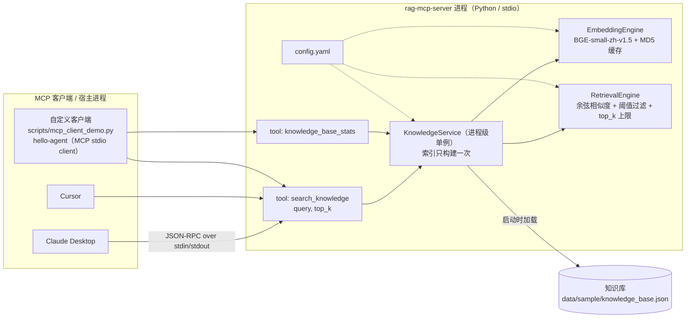

# rag-mcp-server —— 把 RAG 检索能力封装成标准 MCP Server

> 用 **Python + 官方 MCP SDK（stdio 模式）** 把一套 RAG 检索链路暴露成标准 MCP 工具：
> Claude Desktop、Cursor、任意 MCP 客户端（包括我自己写的 [hello-agent](../hello-agent)）都能直接调用。
> **不依赖任何外部 LLM**，装完依赖即可离线运行。

- 工具 1：`search_knowledge(query, top_k=3)` → 返回最相关片段 + 相似度分数（JSON）
- 工具 2：`knowledge_base_stats()` → 返回索引元信息（文档数 / chunk 数 / 模型 / 阈值 / 缓存命中）
- 检索实现：BGE-small-zh-v1.5 向量（512 维）+ NumPy 余弦相似度 + 阈值过滤 + 文本 MD5 缓存
- 与同源项目 [rag-eval-platform](../rag-eval-platform) 的关系：**检索链路同源、最小化移植**（见下文差异表）

---

## 1. 这是什么、为什么需要它

**背景**：LLM 应用里的「工具调用」过去是各家框架各自实现（OpenAI function calling、LangChain Tool、各家插件协议）。
模型要接一个新的数据源，就得为每个框架重写一遍适配代码。

**MCP（Model Context Protocol）** 是 Anthropic 于 2024 年底提出的开放协议，把「模型 ↔ 工具/数据源」的接口标准化为
JSON-RPC 2.0：**一次实现，任何 MCP 客户端都能用**。协议里最常见的两类角色：

| 角色 | 说明 | 本项目 |
|---|---|---|
| **MCP Server** | 暴露能力（tools / resources / prompts） | ✅ 本仓库（`server.py`） |
| **MCP Client / Host** | 承载 LLM、调用 Server 的宿主 | Claude Desktop / Cursor / 自定义客户端 |

**stdio 传输**：客户端把 Server 拉起成一个**子进程**，双方用 `stdin`/`stdout` 交换 JSON-RPC 报文。
它比 HTTP 传输简单（无需端口、无鉴权配置），是本机工具服务器最常用的模式——这也是本项目选它的原因。

**为什么值得把「检索」单独做成一个 Server**：检索是 RAG 系统里最独立、最稳定的一层。
把它做成 MCP Server 后：

- 同一个检索能力可以同时给 Claude Desktop（人工验证）、Cursor、以及自己的 Agent（自动化）复用，**不重复实现**；
- 换 LLM、换 Agent 框架都不影响检索层；
- 检索层的可靠性/指标可以单独验证（不掺进 LLM 的随机性）。

---

## 2. 架构



**一次 `search_knowledge` 调用的完整路径：**

1. 客户端通过 stdin 发送 `tools/call` 报文（JSON-RPC）；
2. Server 进程里的 `search_knowledge` 被调用 → 交给 `KnowledgeService`；
3. `KnowledgeService` 把 query 交给 `EmbeddingEngine` 编码成 512 维向量
   （**query 也走 MD5 缓存**：同一问题重复问不重算）；
4. `RetrievalEngine` 用归一化向量的点积等价计算余弦相似度，取 Top-K，**丢弃低于阈值的候选**；
5. 组装成 JSON（含 `rank/score/source/chunk_index/text` 与 `filtered_by_threshold`），
   经 stdout 返回给客户端。

---

## 3. 与 rag-eval-platform 的关系

**结论：检索链路同源，最小化移植（不修改原仓库）。**

| 维度 | rag-eval-platform（原平台） | 本项目 | 说明 |
|---|---|---|---|
| 定位 | RAG **实验/评测**平台（切分 → 生成 → 三层指标） | RAG 检索的 **MCP 服务化** | 一个做实验，一个做能力输出 |
| 切分 | 3 种策略（fixed_size / recursive / semantic） | **只保留 fixed_size** | 策略对比是评测平台的职责；配置项保留，便于扩展 |
| Embedding | BGE-small-zh-v1.5，文本 MD5 缓存 | **同**（同一模型、同一缓存键算法、同一归一化方式） | 两个仓库产出的向量可互换 |
| 检索 | NumPy 余弦 + 阈值过滤 | **同**，额外返回 `filtered_by_threshold` | 让调用方能区分「库里没有」与「分数被过滤」 |
| 生成 | Qwen2.5 / OpenAI 兼容 API | **无** | 本项目不接 LLM：Server 只负责「给证据」 |
| 评测 | Recall/Precision/MRR + LLM-as-Judge + BLEU/ROUGE | 无（仅 pytest 行为断言） | 指标评测留在评测平台 |
| 数据 | `data/sample/knowledge_base.json` | **同一份文件**（MD5 `44c4034315d556da91e625770da6736f`，字节一致） | 见下「用原平台的数据」 |
| 设备 | config 写死 `cuda` | `device: auto`（无 CUDA 自动回落 CPU） | 保证在任意机器都能跑起来 |
| 服务化 | Gradio Web | **MCP Server（stdio）** | 本项目的新增部分 |

**用原平台的数据**：`config.yaml` 的 `knowledge_base.path` 支持任意路径（文件或目录），
所以可以一行配置直接指向原平台的数据文件，无需改代码：

```yaml
knowledge_base:
  path: "../rag-eval-platform/data/sample/knowledge_base.json"
```

---

## 4. 安装

```bash
# 1) 建独立虚拟环境（Python 3.12 实测）
python -m venv .venv
.venv\Scripts\activate            # Windows
# source .venv/bin/activate       # macOS / Linux

# 2) 装依赖（国内建议加镜像：-i https://pypi.tuna.tsinghua.edu.cn/simple）
pip install -r requirements.txt
```

**关于 BGE 模型**：首次运行会从 HuggingFace 下载 `BAAI/bge-small-zh-v1.5`（约 95MB，缓存在 `~/.cache/huggingface`），
之后 `config.yaml` 的 `embedding.offline: true` 会让程序**只在本地缓存里找模型、完全不联网**。
如果本机没有缓存，把 `offline` 改成 `false` 跑一次即可（下载完成后可以改回 `true`）。

**关于 torch**：PyPI 上的 Windows 版 torch 是 CPU 版（本项目在纯 CPU 上跑，5 篇文档建索引约 5 秒）。
要 GPU 加速就按 [PyTorch 官方指引](https://pytorch.org/get-started/locally/) 装 CUDA 版本，并保持 `device: auto`。

---

## 5. 运行与验证

### 5.1 冒烟测试（不经过 MCP 协议，直接验证检索链路）

```bash
.venv\Scripts\python.exe scripts\smoke_test.py
```

它的作用是**把「检索逻辑错」和「MCP 协议层错」分开定位**：先证明检索本身是对的，再去测协议。

### 5.2 端到端测试（真实 MCP 客户端 ↔ Server 子进程，走完整协议）

```bash
.venv\Scripts\python.exe scripts\mcp_client_demo.py
```

这一步和 Claude Desktop / Cursor 接入走的是**同一条代码路径**：
启动 server 子进程 → `initialize` 握手 → `tools/list` → `tools/call`。

### 5.3 单元测试

```bash
.venv\Scripts\python.exe -m pytest tests -v
```

### 5.4 手工启动 Server（只用来观察日志，正常由客户端拉起）

```bash
.venv\Scripts\python.exe server.py     # 会阻塞等待 stdin 上的 JSON-RPC 报文
```

> ⚠️ 别用 `print` 调试 Server：stdio 模式下 **stdout 是协议通道**，
> 一行 `print` 会让客户端解析报文失败。本项目的日志统一走 **stderr**（见 `rag/logging_utils.py`）。

---

## 6. 接入 Claude Desktop / Cursor

把下面片段合并进客户端配置文件即可（**command 指向本仓库 venv 里的 python，args 指向 `server.py` 的绝对路径**）：

**Claude Desktop**：`%APPDATA%\Claude\claude_desktop_config.json`（macOS：`~/Library/Application Support/Claude/claude_desktop_config.json`）

```json
{
  "mcpServers": {
    "rag-knowledge": {
      "command": "D:\\programmer\\LLM\\projects\\rag-mcp-server\\.venv\\Scripts\\python.exe",
      "args": ["D:\\programmer\\LLM\\projects\\rag-mcp-server\\server.py"]
    }
  }
}
```

**Cursor**：项目内 `.cursor/mcp.json` 或全局 `~/.cursor/mcp.json`（结构相同）

```json
{
  "mcpServers": {
    "rag-knowledge": {
      "command": "D:\\programmer\\LLM\\projects\\rag-mcp-server\\.venv\\Scripts\\python.exe",
      "args": ["D:\\programmer\\LLM\\projects\\rag-mcp-server\\server.py"]
    }
  }
}
```

改完重启客户端，对话里问「按知识库说说 LoRA 的原理」，模型就会调用 `search_knowledge` 并基于返回片段作答。
（换知识库只需改 `config.yaml` 里的 `knowledge_base.path`，客户端配置不用动。）

---

## 7. 工具说明

### `search_knowledge(query: str, top_k: int = 3) -> str(JSON)`

| 字段 | 含义 |
|---|---|
| `query` / `top_k` | 回显请求；`top_k` 会被 `max_top_k`（默认 10）截断并置 `top_k_truncated: true` |
| `similarity_threshold` | 本次使用的阈值（默认 0.3） |
| `matched` | 实际返回条数 |
| `filtered_by_threshold` | **被阈值丢弃**的候选数 |
| `elapsed_ms` | 检索耗时（含 query 编码） |
| `results[]` | `rank` / `score`（余弦相似度，保留 4 位）/ `source` / `chunk_index` / `text` |
| `hint` | 仅在 `matched == 0` 时出现：解释为什么没有结果 |

示例返回（真实日志，见 §8.1）：

```json
{
  "query": "Transformer 的自注意力机制是怎么计算的？",
  "top_k": 2,
  "top_k_truncated": false,
  "similarity_threshold": 0.3,
  "matched": 2,
  "filtered_by_threshold": 0,
  "elapsed_ms": 0.4,
  "results": [
    {
      "rank": 1,
      "score": 0.692,
      "source": "transformer.txt",
      "chunk_index": 1,
      "text": "Transformer架构由Vaswani等人在2017年提出，核心组件包括：..."
    }
  ]
}
```

### `knowledge_base_stats() -> str(JSON)`

返回知识库路径、文档数、chunk 数、来源文件列表、embedding 模型与设备、向量维度、
阈值、`top_k` 上限、缓存命中/未命中次数、索引构建次数与耗时、累计检索次数。
**用途**：调用方（或模型自己）先判断知识库覆盖了什么，再决定要不要检索。

---

## 8. 真实运行日志

> 环境：Windows / Python 3.12.9 / mcp 2.3.0 / sentence-transformers 5.7.0 / torch 2.14.1（CPU）/ 2026-10-16。
> 下面三段日志均为**原样粘贴**（仅省略进度条与超长 JSON 中段，省略处标注 `（略）`）。

### 8.1 冒烟测试（`python scripts\smoke_test.py`）

```text
[13:06:00] INFO | rag_mcp | 从 JSON 加载了 5 个文档：knowledge_base.json
[13:06:00] INFO | rag_mcp | 切分完成：1 个 chunk（size=512, overlap=50）      ← 5 篇文档各 1 个 chunk
[13:06:05] INFO | rag_mcp | 加载 Embedding 模型：BAAI/bge-small-zh-v1.5（device=cpu, offline=True）
[1/3] 加载配置并启动检索服务 ...
      配置文件：D:\programmer\LLM\projects\rag-mcp-server\config.yaml
      知识库：  D:\programmer\LLM\projects\rag-mcp-server\data\sample\knowledge_base.json
[2/3] 构建索引（首次运行会算向量并写 MD5 缓存）...
[13:06:05] INFO | rag_mcp | 模型加载完成，向量维度：512
[13:06:05] INFO | rag_mcp | Embedding 缓存命中 → 4c537b94bcca1b858d3e8ba05a203ba9.npy
[13:06:05] INFO | rag_mcp | 索引构建完成：5 篇文档 → 5 个 chunk，维度 512，耗时 4.735s
      文档 5 篇 → chunk 5 个 | 模型 BAAI/bge-small-zh-v1.5 (cpu, 512 维) | 建索引 4.735s | 缓存命/未命中 1/0
[3/3] 逐条检索（每条只返回 score >= 阈值的片段）...

--- 探针 1：Transformer 的自注意力机制是怎么计算的？
    matched=3 filtered_by_threshold=0 elapsed=0.34ms
    rank=1 score=0.692 source=transformer.txt | Transformer架构由Vaswani等人在2017年提出，核心组件包括：  1. 自注意力机制（Self-Atte...
    rank=2 score=0.5151 source=quantization.txt | 模型量化是将浮点模型参数转换为低位整数表示的技术，目的是减少模型大小和推理延迟。  常见量化方法： - INT8量化：F...
    rank=3 score=0.5098 source=rag_guide.txt | 检索增强生成（RAG）系统的核心组件和优化策略：  1. 文档处理：将原始文档切分为适当大小的chunk。chunk_s...

--- 探针 2：LoRA 微调的原理和典型参数是什么？
    matched=3 filtered_by_threshold=0 elapsed=0.28ms
    rank=1 score=0.6234 source=finetuning.txt | 大语言模型的微调技术主要包括：  1. 全参数微调（Full Fine-Tuning）：更新所有模型参数，效果最好但计算...
    rank=2 score=0.5143 source=quantization.txt | 模型量化是将浮点模型参数转换为低位整数表示的技术，目的是减少模型大小和推理延迟。  常见量化方法： - INT8量化：F...
    rank=3 score=0.4978 source=transformer.txt | Transformer架构由Vaswani等人在2017年提出，核心组件包括：  1. 自注意力机制（Self-Atte...

--- 探针 3：今天武汉的天气怎么样？                      ← 故意问知识库里没有的内容
    matched=0 filtered_by_threshold=3 elapsed=0.49ms
    hint: 知识库中没有相似度高于阈值的内容：本次候选 3 条因分数 < 0.3 被过滤。可换一种问法，或改用知识库里的术语重述问题。

完整结构化返回（以第 1 条探针为例）：
{
  "query": "Transformer 的自注意力机制是怎么计算的？",
  "top_k": 2, "top_k_truncated": false, "similarity_threshold": 0.3,
  "matched": 2, "filtered_by_threshold": 0, "elapsed_ms": 0.4,
  "results": [
    {"rank": 1, "score": 0.692, "source": "transformer.txt", "chunk_index": 1, "text": "Transformer架构由Vaswani等人在2017年提出...（略）"},
    {"rank": 2, "score": 0.5151, "source": "quantization.txt", "chunk_index": 3, "text": "模型量化是将浮点模型参数转换为低位整数表示的技术...（略）"}
  ]
}

[OK] 检索链路可用（模型加载 + 索引 + 检索 + 阈值过滤 + 空结果降级）
```

**读这段日志能看出来什么**：

- **索引构建 4.735s 中绝大部分是模型加载**；真正的一次检索只有 **0.28–0.49ms**（query 已命中缓存）。
  这就是「文档不变不重算 + 索引常驻内存」的效果：成本的形状是「一次性的贵 + 每次的极便宜」。
- 探针 3 是**领域外问题**，`matched=0 / filtered_by_threshold=3`：知识库里没有的内容**不会被硬凑答案**，
  而是走「明确告知 + 给建议」的降级路径。这条路径是上层 Agent 能否诚实的**前提**。
- 相似度排序符合直觉：问 Transformer 时 `transformer.txt` 第一（0.692），问 LoRA 时 `finetuning.txt` 第一（0.6234）。

### 8.2 MCP 端到端（`python scripts\mcp_client_demo.py`，客户端与 Server 是两个进程）

```text
[server stderr, 启动预热]
[13:05:37] INFO | rag_mcp.server | MCP Server 启动：rag-mcp-server v0.1.0（stdio）
[13:05:37] INFO | rag_mcp.server | 知识库：D:\programmer\LLM\projects\rag-mcp-server\data\sample\knowledge_base.json
[13:05:37] INFO | rag_mcp | 索引构建完成：5 篇文档 → 5 个 chunk，维度 512，耗时 5.235s
[13:05:37] INFO | rag_mcp | 预热完成，耗时 5.235s

[client stdout]
[client] 启动 server 子进程：D:\programmer\LLM\projects\rag-mcp-server\.venv\Scripts\python.exe server.py
[client] initialize OK → server=rag-mcp-server v0.1.0
[client] tools/list → 2 个工具：['search_knowledge', 'knowledge_base_stats']
         - search_knowledge: 检索本地知识库（中文技术文档），返回最相关的若干原文片段与相似度分数。适用场景：用户问题可能依赖私有/本地资料时，先调用本工具拿证据再回答。...
         - knowledge_base_stats: 返回知识库索引的元信息（文档数、chunk 数、来源文件列表、embedding 模型与维度、相似度阈值、缓存命中次数等）...

[client] tools/call search_knowledge(query='LoRA 微调是怎么工作的？', top_k=2)
         isError=False matched=2 filtered_by_threshold=0
         rank=1 score=0.5393 source=finetuning.txt | 大语言模型的微调技术主要包括：  1. 全参数微调（Full Fine-Tuning）：更新所有模型...
         rank=2 score=0.419 source=transformer.txt | Transformer架构由Vaswani等人在2017年提出，核心组件包括：  1. 自注意力机制...

[client] tools/call search_knowledge(query='RAG 系统怎么做检索优化？', top_k=2)
         isError=False matched=2 filtered_by_threshold=0
         rank=1 score=0.6731 source=rag_guide.txt | 检索增强生成（RAG）系统的核心组件和优化策略：  1. 文档处理：将原始文档切分为适当大小的chu...
         rank=2 score=0.4977 source=quantization.txt | 模型量化是将浮点模型参数转换为低位整数表示的技术，目的是减少模型大小和推理延迟。  常见量化方法： ...

[client] tools/call search_knowledge(query='明天武汉天气如何？', top_k=2)
         isError=False matched=0 filtered_by_threshold=2
         hint: 知识库中没有相似度高于阈值的内容：本次候选 2 条因分数 < 0.3 被过滤。可换一种问法，或改用知识库里的术语重述问题。

[client] tools/call knowledge_base_stats → 文档=5 chunk=5 维度=512 缓存命中=1

[OK] MCP stdio 端到端调用成功（客户端与 server 是两个进程，走 JSON-RPC）
```

> 复现时如果先去 `tests/` 或 `scripts/smoke_test.py` 跑过一次，`缓存命中` 计数会更大——这是缓存生效的正常表现。

### 8.3 单元测试（`python -m pytest tests -v`）

```text
platform win32 -- Python 3.12.9, pytest-9.1.1, pluggy-1.7.0 -- .venv\Scripts\python.exe
collected 6 items

tests/test_service.py::test_index_stats PASSED                           [ 16%]
tests/test_service.py::test_search_returns_ranked_results PASSED         [ 33%]
tests/test_service.py::test_top_k_is_capped PASSED                       [ 50%]
tests/test_service.py::test_out_of_domain_query_is_filtered PASSED       [ 66%]
tests/test_service.py::test_empty_query_rejected PASSED                  [ 83%]
tests/test_service.py::test_result_is_json_serializable PASSED           [100%]

============================== 6 passed in 4.86s ==============================
```

测试断言的都是**行为契约**（不是快照）：分数降序、`top_k` 被上限截断、领域外问题必须被过滤且给 `hint`、
空 query 必须报错、返回值必须可 JSON 序列化。

---

## 9. 设计取舍（面试可以讲的部分）

| 决策 | 为什么这么做 | 不这么做会怎样 |
|---|---|---|
| **日志一律走 stderr** | stdio 模式下 stdout 是 JSON-RPC 通道 | 一行 `print` 就破坏协议，客户端报解析错误 |
| **检索与协议分层**（`service` / `server.py`） | 换传输协议（stdio→HTTP）不用动检索代码；测检索不需要起协议 | 逻辑和协议耦在一起，只能靠端到端调试 |
| **索引懒加载 + 启动预热** | 把 5s 的模型加载挪到启动阶段，避免首次工具调用撞客户端超时 | 第一次调用延迟过大，宿主可能判定超时 |
| **`top_k` 硬上限 `max_top_k`** | 工具返回值会直接进模型上下文；不设上限等于把「上下文成本」交给模型乱填 | 一次调用塞进几万 token，成本和延迟失控 |
| **相似度阈值过滤 + `filtered_by_threshold`** | 「检索不到」和「检索到但不相关」是两种不同状态，必须能区分 | 上层无法判断该换问法还是该放弃（对应 Agent 的失败分类） |
| **空结果不抛异常，返回结构化 `hint`** | 「知识库里没有」是正常业务结果，不是工具故障 | 抛异常会让 Agent 走进「重试」路径，白白重试一次必然失败的操作 |
| **query 也走 MD5 缓存** | 同一问题被反复问时（Agent 多轮里很常见）零成本 | 每次都重算向量，浪费算力 |
| **`device: auto` + `offline: true`** | 有 GPU 用 GPU、没有就 CPU；模型缓存后完全离线可复现 | 换台机器就要改配置/联网，演示时容易翻车 |
| **忘记 `similarity_threshold` 为什么是 0.3** | 与同源平台保持一致口径；它在样例集上能过滤掉领域外问题（见探针 3），属于经验值 | —— |
| **只用 NumPy 暴力检索** | 几十~几百 chunk 规模下矩阵乘法不是瓶颈，换来零依赖、行为完全可解释 | 引入向量库会多一层运维与调试成本，收益在万级 chunk 才显现 |

### MCP 协议版本说明（踩过的坑，如实记录）

- 最新的官方 SDK 是 **mcp 2.x**：`FastMCP` 已更名为 **`MCPServer`**（`from mcp.server.mcpserver import MCPServer`），
  且响应字段从 camelCase 改成 snake_case（如 `InitializeResult.server_info`）。
  网上大量教程仍是 1.x 时代的 `from mcp.server.fastmcp import FastMCP`，**照着抄会直接 `ModuleNotFoundError`**。
- 本项目固定 `mcp==2.3.0` 并按 2.x API 编写；`scripts/mcp_client_demo.py` 里对 `server_info`、`is_error`
  做了新旧字段兼容（`getattr` 兜底），方便在不同 SDK 版本上排查问题。
- 另一个真实差异：**`langchain-mcp-adapters` 目前要求 `mcp<2`**，所以 [hello-agent](../hello-agent) 
  作为客户端用的是 mcp 1.x——也就是说**同一个协议、客户端 1.x、服务端 2.x 可以互通**（双方都实现的是协议本身）。

---

## 10. 目录结构

```text
rag-mcp-server/
├── server.py                  # MCP Server 入口（stdio）：工具定义 + 预热 + 日志纪律
├── config.yaml                # 知识库路径 / 切分 / embedding / 检索 / server 配置
├── requirements.txt           # 固定版本依赖（实测通过）
├── rag/
│   ├── config.py              # 配置加载：默认值合并 + 相对路径解析 + device 自动探测
│   ├── logging_utils.py       # 日志统一写 stderr（保住 stdout 给协议）
│   ├── chunking.py            # 固定窗口切分（最小移植）
│   ├── embedding.py           # BGE-small-zh-v1.5 + 文本 MD5 缓存 + 离线开关
│   ├── retrieval.py           # 余弦相似度 + 阈值过滤 + top_k 上限
│   └── service.py             # KnowledgeService：加载 → 建索引 → 检索（进程级单例）
├── scripts/
│   ├── smoke_test.py          # 冒烟：不经协议，直接验证检索链路（含领域外问题探针）
│   └── mcp_client_demo.py     # 端到端：官方 MCP 客户端 stdio 调用（含 tools/list）
├── tests/
│   └── test_service.py        # 6 个行为契约测试
└── data/sample/
    └── knowledge_base.json    # 示例知识库（5 篇中文技术短文，与 rag-eval-platform 同源同文件）
```

---

## 11. 已知边界（如实说明）

- **知识库规模**：样例 5 篇文档 / 5 个 chunk。更大规模（万级 chunk）应换 Faiss / 向量库，
  并考虑 BM25+向量的混合检索与重排（Rerank）——本项目**没有**实现这些。
- **检索质量**：没有做重排、没有做查询改写（HyDE / multi-query）、没有 chunk 级评测集，
  因此**无法给出 Recall@K 之类的正式指标**；本项目只对「行为契约」做了测试。
  检索效果的正式评测在 [rag-eval-platform](../rag-eval-platform) 侧（三层指标 + 真实实验数据）。
- **切分策略**：只移植了固定窗口切分；原平台的 recursive / semantic 未移植。
- **传输模式**：只实现 stdio；HTTP（streamable-http / SSE）没实现（多用户场景才需要）。
- **鉴权**：stdio 是本机子进程模式，无鉴权；做成网络服务时必须另行加鉴权与限流。

## License

MIT
