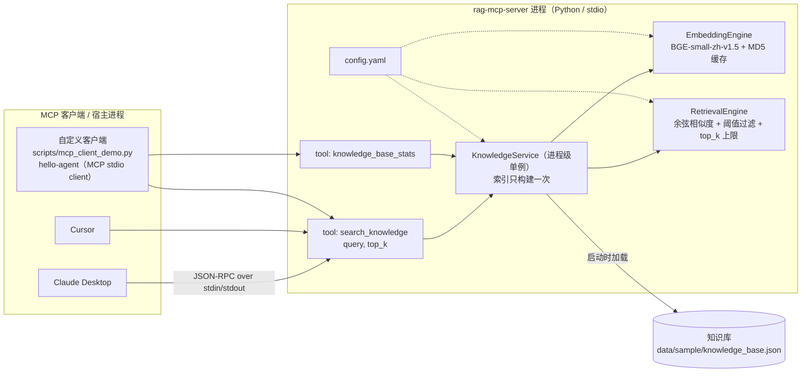

# rag-mcp-server —— 把 RAG 检索能力封装成标准 MCP Server

> 用 **Python + 官方 MCP SDK（stdio 模式）** 把一套 RAG 检索链路暴露成标准 MCP 工具：
> Claude Desktop、Cursor、任意 MCP 客户端（包括我自己写的 [hello-agent](../hello-agent)）都能直接调用。
> **不依赖任何外部 LLM**，装完依赖即可离线运行。

- 工具 1：`search_knowledge(query, top_k=3)` → 返回最相关片段 + 相似度分数（JSON）
- 工具 2：`knowledge_base_stats()` → 返回索引元信息（文档数 / chunk 数 / 模型 / 阈值 / 缓存命中）
- 检索实现：BGE-small-zh-v1.5 向量（512 维）+ NumPy 余弦相似度 + 阈值过滤 + 文本 MD5 缓存
- HTTP 生产化（§5.6）：Bearer 鉴权、令牌桶限流、`/healthz`、Prometheus `/metrics`（零额外依赖）、
  Dockerfile、压测脚本 `scripts/bench_http.py`（本机实测 ~250 QPS / p99 ~113ms，0 错误）
- 与同源项目 [rag-eval-platform](../rag-eval-platform) 的关系：**检索链路同源、最小化移植**（见下文差异表）

---

## 1. 这是什么、为什么需要它

**背景**：LLM 应用里的「工具调用」过去是各家框架各自实现（OpenAI function calling、LangChain Tool、各家插件协议）。
模型要接一个新的数据源，就得为每个框架重写一遍适配代码。

**MCP（Model Context Protocol）** 是 Anthropic 于 2024 年底提出的开放协议，把「模型 ↔ 工具/数据源」的接口标准化为
JSON-RPC 2.0：**一次实现，任何 MCP 客户端都能用**。协议里最常见的两类角色：

| 角色 | 说明 | 本项目 |
|---|---|---|
| **MCP Server** | 暴露能力（tools / resources / prompts） | ✅ 本仓库（`server.py`） |
| **MCP Client / Host** | 承载 LLM、调用 Server 的宿主 | Claude Desktop / Cursor / 自定义客户端 |

**stdio 传输**：客户端把 Server 拉起成一个**子进程**，双方用 `stdin`/`stdout` 交换 JSON-RPC 报文。
它比 HTTP 传输简单（无需端口、无鉴权配置），是本机工具服务器最常用的模式——这也是本项目选它的原因。

**为什么值得把「检索」单独做成一个 Server**：检索是 RAG 系统里最独立、最稳定的一层。
把它做成 MCP Server 后：

- 同一个检索能力可以同时给 Claude Desktop（人工验证）、Cursor、以及自己的 Agent（自动化）复用，**不重复实现**；
- 换 LLM、换 Agent 框架都不影响检索层；
- 检索层的可靠性/指标可以单独验证（不掺进 LLM 的随机性）。

---

## 2. 架构



**一次 `search_knowledge` 调用的完整路径：**

1. 客户端通过 stdin 发送 `tools/call` 报文（JSON-RPC）；
2. Server 进程里的 `search_knowledge` 被调用 → 交给 `KnowledgeService`；
3. `KnowledgeService` 把 query 交给 `EmbeddingEngine` 编码成 512 维向量
   （**query 也走 MD5 缓存**：同一问题重复问不重算）；
4. `RetrievalEngine` 用归一化向量的点积等价计算余弦相似度，取 Top-K，**丢弃低于阈值的候选**；
5. 组装成 JSON（含 `rank/score/source/chunk_index/text` 与 `filtered_by_threshold`），
   经 stdout 返回给客户端。

---

## 3. 与 rag-eval-platform 的关系

**结论：检索链路同源，最小化移植（不修改原仓库）。**

| 维度 | rag-eval-platform（原平台） | 本项目 | 说明 |
|---|---|---|---|
| 定位 | RAG **实验/评测**平台（切分 → 生成 → 三层指标） | RAG 检索的 **MCP 服务化** | 一个做实验，一个做能力输出 |
| 切分 | 3 种策略（fixed_size / recursive / semantic） | **只保留 fixed_size** | 策略对比是评测平台的职责；配置项保留，便于扩展 |
| Embedding | BGE-small-zh-v1.5，文本 MD5 缓存 | **同**（同一模型、同一缓存键算法、同一归一化方式） | 两个仓库产出的向量可互换 |
| 检索 | NumPy 余弦 + 阈值过滤 | **同**，额外返回 `filtered_by_threshold` | 让调用方能区分「库里没有」与「分数被过滤」 |
| 生成 | Qwen2.5 / OpenAI 兼容 API | **无** | 本项目不接 LLM：Server 只负责「给证据」 |
| 评测 | Recall/Precision/MRR + LLM-as-Judge + BLEU/ROUGE | 无（仅 pytest 行为断言） | 指标评测留在评测平台 |
| 数据 | `data/sample/knowledge_base.json` | **同一份文件**（MD5 `44c4034315d556da91e625770da6736f`，字节一致） | 见下「用原平台的数据」 |
| 设备 | config 写死 `cuda` | `device: auto`（无 CUDA 自动回落 CPU） | 保证在任意机器都能跑起来 |
| 服务化 | Gradio Web | **MCP Server（stdio）** | 本项目的新增部分 |

**用原平台的数据**：`config.yaml` 的 `knowledge_base.path` 支持任意路径（文件或目录），
所以可以一行配置直接指向原平台的数据文件，无需改代码：

```yaml
knowledge_base:
  path: "../rag-eval-platform/data/sample/knowledge_base.json"
```

---

## 4. 安装

```bash
# 1) 建独立虚拟环境（Python 3.12 实测）
python -m venv .venv
.venv\Scripts\activate            # Windows
# source .venv/bin/activate       # macOS / Linux

# 2) 装依赖（国内建议加镜像：-i https://pypi.tuna.tsinghua.edu.cn/simple）
pip install -r requirements.txt
```

**关于 BGE 模型**：首次运行会从 HuggingFace 下载 `BAAI/bge-small-zh-v1.5`（约 95MB，缓存在 `~/.cache/huggingface`），
之后 `config.yaml` 的 `embedding.offline: true` 会让程序**只在本地缓存里找模型、完全不联网**。
如果本机没有缓存，把 `offline` 改成 `false` 跑一次即可（下载完成后可以改回 `true`）。

**关于 torch**：PyPI 上的 Windows 版 torch 是 CPU 版（本项目在纯 CPU 上跑，5 篇文档建索引约 5 秒）。
要 GPU 加速就按 [PyTorch 官方指引](https://pytorch.org/get-started/locally/) 装 CUDA 版本，并保持 `device: auto`。

---

## 5. 运行与验证

### 5.1 冒烟测试（不经过 MCP 协议，直接验证检索链路）

```bash
.venv\Scripts\python.exe scripts\smoke_test.py
```

它的作用是**把「检索逻辑错」和「MCP 协议层错」分开定位**：先证明检索本身是对的，再去测协议。

### 5.2 端到端测试（真实 MCP 客户端 ↔ Server 子进程，走完整协议）

```bash
.venv\Scripts\python.exe scripts\mcp_client_demo.py
```

这一步和 Claude Desktop / Cursor 接入走的是**同一条代码路径**：
启动 server 子进程 → `initialize` 握手 → `tools/list` → `tools/call`。

### 5.3 单元测试

```bash
.venv\Scripts\python.exe -m pytest tests -v
```

> 本机实测 **46 passed**：检索行为契约 8（`test_service.py`）＋ 传输 8（`test_http_transport.py`）
> ＋ HTTP 安全 30（`test_http_security.py`，含 1 个子进程端到端用例）。
> ⚠️ 跑 HTTP 相关用例前若本机挂了全局代理，先设 `NO_PROXY=127.0.0.1,localhost`——
> 否则对 `127.0.0.1` 的请求会被代理转发，回一个与预期不符的 502。

### 5.4 手工启动 Server（只用来观察日志，正常由客户端拉起）

```bash
.venv\Scripts\python.exe server.py     # 会阻塞等待 stdin 上的 JSON-RPC 报文
```

> ⚠️ 别用 `print` 调试 Server：stdio 模式下 **stdout 是协议通道**，
> 一行 `print` 会让客户端解析报文失败。本项目的日志统一走 **stderr**（见 `rag/logging_utils.py`）。

### 5.5 三种传输方式（stdio / Streamable HTTP / SSE）

**业务检索代码完全不变，只换传输层**——这是「协议层与核心逻辑解耦」的直接收益：
`KnowledgeService` 不感知 MCP，`server.py` 只负责把工具挂到不同 transport 上。

| 传输 | 适用场景 | 端点 | 默认 |
|------|----------|------|------|
| `stdio` | 本地客户端拉起子进程（Claude Desktop / Cursor） | stdin/stdout | ✅ |
| `streamable-http` | 远程部署、多客户端共享、Web 前端、容器 | `http://host:port/mcp` | 推荐 HTTP |
| `sse` | 旧版 HTTP 客户端兼容 | `/sse` + `/messages/` | 保留 |

启动方式（优先级：**命令行 > 环境变量 > config.yaml > 代码默认值**）：

```bash
# 1) stdio（默认，行为与之前完全一致）
.venv\Scripts\python.exe server.py

# 2) Streamable HTTP（推荐远程）
.venv\Scripts\python.exe server.py --transport streamable-http --host 127.0.0.1 --port 8000
#    端点：http://127.0.0.1:8000/mcp

# 3) 旧版 SSE
.venv\Scripts\python.exe server.py --transport sse --port 8000
#    端点：http://127.0.0.1:8000/sse

# 4) 环境变量方式（容器 / CI 常用，无需改配置文件）
RAG_MCP_TRANSPORT=streamable-http RAG_MCP_HOST=0.0.0.0 RAG_MCP_PORT=8000 \
  .venv\Scripts\python.exe server.py
```

可选参数：

- `--stateless`：无状态模式，不保存会话（多实例 / 负载均衡部署时开启）；
- `--json-response`：Streamable HTTP 返回普通 JSON 而非 SSE 流（便于 curl / httpx 调试）；
- `--path`：自定义 HTTP 路径（默认 `/mcp` 或 `/sse`）。

HTTP 客户端接入（Cursor / 支持远程 MCP 的客户端）：

```json
{
  "mcpServers": {
    "rag-knowledge": {
      "url": "http://127.0.0.1:8000/mcp"
    }
  }
}
```

> 不同客户端版本的字段名可能略有差异（`url` / `type` / `transport`），以客户端文档为准；
> stdio 的配置方式见下一节，两种方式可同时存在。

**验证 HTTP 链路**（先启动 server，再另开终端）：

```bash
.venv\Scripts\python.exe scripts\mcp_http_client_demo.py --port 8000
# 或：--transport sse --port 8000 / --url http://127.0.0.1:8000/mcp
```

该脚本走与 stdio 版相同的完整协议：`initialize → tools/list → tools/call`，
只是底层从 stdin/stdout 换成了 HTTP。

**安全与部署注意**：

- 默认只绑定 `127.0.0.1`，本机可用；对外提供服务改 `--host 0.0.0.0`。
  **对外暴露必须开鉴权**：本项目已内置 **Bearer Token 鉴权 + 令牌桶限流**（§5.6），
  也可叠加反向代理 / API 网关侧鉴权。
- SDK 对 `127.0.0.1 / localhost / ::1` 自动开启 DNS rebinding 防护（校验 Host / Origin）；
  绑定 `0.0.0.0` 或用域名访问时，建议在 `config.yaml` 显式配置：
  ```yaml
  server:
    allowed_hosts: ["127.0.0.1:*", "rag.example.com"]
    allowed_origins: ["http://localhost:*", "https://rag.example.com"]
  ```
  否则可能被 Host/Origin 校验拒绝（HTTP 421）。
- 生产环境建议加 `--stateless` 做水平扩展（会话不落在单实例内存里）。

**本机实测（2026-10-18）**：`streamable-http` 端到端通过——`initialize` → `tools/list`（2 个工具）→
`search_knowledge`（LoRA / RAG 命中，领域外问题被阈值过滤）→ `knowledge_base_stats`；
全量测试 **46 passed**，`stdio` 行为零回归。HTTP 生产化加固见 **§5.6**、容器见 **§5.7**、压测数据见 **§8.4**。

---

### 5.6 HTTP 生产化（鉴权 / 限流 / 健康检查 / 指标）

> 四项能力**全部零额外依赖**：`rag/http_security.py`（纯 ASGI 中间件）+ `rag/metrics.py`（手写 Prometheus 文本）。
> 为什么不用 SDK 自带的 OAuth `token_verifier`：本场景只需要「一个共享 Token」，自己写的中间件不依赖 Starlette、
> 可直接单测，也不会碰请求体（不破坏 streamable-http 的 SSE 流式响应）。取舍见 §9。

**能力总览**（都只作用于 HTTP 传输，`stdio` 完全不受影响）：

| 能力 | 怎么开 | 行为 |
|---|---|---|
| **Bearer 鉴权** | `server.auth.enabled: true` + `server.auth.token`（或用环境变量 `RAG_MCP_AUTH_TOKEN`，**设了它即自动开鉴权**） | 缺/错 Token → **401** JSON（带 `WWW-Authenticate`） |
| **令牌桶限流** | `server.rate_limit.rps` > 0（默认 `0` = 关闭） | 按 Token 分桶、匿名按客户端 IP；超限 → **429** + `Retry-After` |
| **健康检查** | 恒开（无需配置） | `GET /healthz` → 200，**只读快照、绝不触发建索引** |
| **Prometheus 指标** | 恒开（无需配置） | `GET /metrics` → `text/plain; version=0.0.4` |

配置（`config.yaml`；优先级 **命令行 > 环境变量 > config.yaml > 代码默认值**）：

```yaml
server:
  auth:
    enabled: false         # 打开后 HTTP 请求必须带 Authorization: Bearer <token>
    token: ""              # 建议留空，改用环境变量 RAG_MCP_AUTH_TOKEN（更安全的密钥外置）
  rate_limit:
    rps: 0                 # 令牌桶速率（个/秒）；<=0 = 关闭限流（默认关闭，不打扰本地/压测）
    burst: 0               # 桶容量（允许的突发量）；<=0 时取 ceil(rps)
  security_exempt_paths: ["/healthz", "/metrics"]   # 鉴权 / 限流的豁免路径
```

环境变量覆盖（容器 / CI 常用，**优先级高于 config.yaml**）：

```bash
# 只设 Token 即自动开启鉴权；再叠加限流
RAG_MCP_AUTH_TOKEN=please-change-me \
RAG_MCP_RATE_LIMIT_RPS=20 RAG_MCP_RATE_LIMIT_BURST=40 \
  .venv\Scripts\python.exe server.py --transport streamable-http --host 0.0.0.0 --port 8000
```

调用示例（`curl`）：

```bash
# 1) 健康检查（匿名可访问，不建索引）
curl -i http://127.0.0.1:8000/healthz
# HTTP/1.1 200 OK
# {"status":"ok","index_ready":true,"documents":5,"chunks":5,"version":"0.1.0","uptime_seconds":12.3}

# 2) 指标（匿名可访问）
curl -i http://127.0.0.1:8000/metrics | head -20

# 3) 不带 Token 调用 MCP 端点 → 401
curl -i http://127.0.0.1:8000/mcp
# HTTP/1.1 401 Unauthorized
# {"error":"unauthorized","detail":"缺少或无效的 Authorization: Bearer <token>"}

# 4) 带上正确 Token → 正常进入 MCP 协议
curl -i -H "Authorization: Bearer please-change-me" http://127.0.0.1:8000/mcp
```

> ⚠️ `/healthz` 与 `/metrics` **不鉴权、不限流**（k8s 探针 / Prometheus 抓取器必须能匿名访问，
> 见 `server.security_exempt_paths`）。若部署到公网，请用反向代理把这两个端点限制在内网/白名单。

**指标清单**（名字与 `rag/metrics.py` 一一对应）：

| 指标 | 类型 | 含义 |
|---|---|---|
| `rag_mcp_requests_total{status}` | counter | HTTP 请求总数（按状态码分组，**含 401/429 拒绝**） |
| `rag_mcp_tool_calls_total{tool}` | counter | 工具调用总数（按工具名分组） |
| `rag_mcp_errors_total` | counter | 错误总数（HTTP 5xx ＋ 工具内部异常） |
| `rag_mcp_request_duration_ms{quantile}` | summary | 请求耗时（毫秒）的 p50/p95/p99 估算值 + `_count` / `_sum` |
| `rag_mcp_auth_failures_total` | counter | 鉴权失败（401）次数 |
| `rag_mcp_rate_limited_total` | counter | 被限流拒绝（429）次数 |
| `rag_mcp_uptime_seconds` | gauge | 指标表存活时长（判断是否重启过） |

#### 5.6.1 鉴权为什么这样设计

- **单一共享 Token + `hmac.compare_digest`**：恒定时间比较，避免时序侧信道；Token 用环境变量注入，不落配置文件。
- **fail fast**：`auth.enabled=true` 却没配 Token → 启动即抛 `ValueError`，**绝不静默放行**（"配了鉴权却没生效" 比"没配鉴权"更危险）。
- **只挡 HTTP**：`stdio` 是同一台机器上的父子进程，没有网络入口，鉴权无意义，因此不介入。

#### 5.6.2 限流为什么这样设计

- **限流在鉴权之前**：未携带正确 Token 的洪水请求同样吃 CPU（协议解析 / TLS / 日志），先限流才能挡住"拿错误 Token 暴力猜"。
- **按身份分桶**（有 Token 按 Token，否则按客户端 IP）：单个客户端打满配额**不影响**其他客户端。
- **令牌桶（惰性补充）**：允许最多 `burst` 个突发，同时把**平均速率**卡在 `rps`；空桶客户端不占后台线程。
- **默认关闭**（`rps: 0`）：本地开发 / 压测默认不受打扰，生产再显式打开。
- **单实例内存态**：多副本部署时每个进程各有一套桶（有 N 个副本就近似 N 倍总额度）；需要全局精确限流应放到网关 / Redis。
  限流桶表有上限（默认 4096 个 key），超出优先淘汰"已回满"的桶（无状态损失）。

### 5.7 Docker 部署

`Dockerfile`：基础镜像 `python:3.12-slim`、**非 root 用户**运行、`EXPOSE 8000`、
`HEALTHCHECK` 打 `/healthz`、`CMD` 为
`python server.py --transport streamable-http --host 0.0.0.0 --port 8000`。

```bash
# 构建
docker build -t rag-mcp-server:dev .

# 运行（把模型缓存挂出来，避免每次重建镜像都重新下载 BGE 模型）
docker run --rm -p 8000:8000 \
  -e RAG_MCP_TRANSPORT=streamable-http \
  -e RAG_MCP_HOST=0.0.0.0 \
  -e RAG_MCP_AUTH_TOKEN=please-change-me \
  -v rag-hf-cache:/home/app/.cache/huggingface \
  rag-mcp-server:dev
```

> ⚠️ **Dockerfile 未在本机验证**：开发机未安装 Docker，`Dockerfile` / `.dockerignore` 是按最佳实践编写、
> **未实际 `docker build` 运行过的**产物，首次构建可能需要按你所在网络环境微调
> （例如模型需能从 HuggingFace 拉取）。容器内**首次启动要联网下载** `BAAI/bge-small-zh-v1.5`，
> 因此容器场景下**不要**把 `RAG_MCP_EMBEDDING_OFFLINE` 设为 `true`（那是裸机离线演示用的开关）；
> 用上面的 `-v` 挂载缓存后，重建镜像不会再下载。

---

## 6. 接入 Claude Desktop / Cursor

把下面片段合并进客户端配置文件即可（**command 指向本仓库 venv 里的 python，args 指向 `server.py` 的绝对路径**）：

**Claude Desktop**：`%APPDATA%\Claude\claude_desktop_config.json`（macOS：`~/Library/Application Support/Claude/claude_desktop_config.json`）

```json
{
  "mcpServers": {
    "rag-knowledge": {
      "command": "D:\\programmer\\LLM\\projects\\rag-mcp-server\\.venv\\Scripts\\python.exe",
      "args": ["D:\\programmer\\LLM\\projects\\rag-mcp-server\\server.py"]
    }
  }
}
```

**Cursor**：项目内 `.cursor/mcp.json` 或全局 `~/.cursor/mcp.json`（结构相同）

```json
{
  "mcpServers": {
    "rag-knowledge": {
      "command": "D:\\programmer\\LLM\\projects\\rag-mcp-server\\.venv\\Scripts\\python.exe",
      "args": ["D:\\programmer\\LLM\\projects\\rag-mcp-server\\server.py"]
    }
  }
}
```

改完重启客户端，对话里问「按知识库说说 LoRA 的原理」，模型就会调用 `search_knowledge` 并基于返回片段作答。
（换知识库只需改 `config.yaml` 里的 `knowledge_base.path`，客户端配置不用动。）

---

## 7. 工具说明

### `search_knowledge(query: str, top_k: int = 3) -> str(JSON)`

| 字段 | 含义 |
|---|---|
| `query` / `top_k` | 回显请求；`top_k` 会被 `max_top_k`（默认 10）截断并置 `top_k_truncated: true` |
| `similarity_threshold` | 本次使用的阈值（默认 0.3） |
| `matched` | 实际返回条数 |
| `filtered_by_threshold` | **被阈值丢弃**的候选数 |
| `elapsed_ms` | 检索耗时（含 query 编码） |
| `results[]` | `rank` / `score`（余弦相似度，保留 4 位）/ `source` / `chunk_index` / `text` |
| `hint` | 仅在 `matched == 0` 时出现：解释为什么没有结果 |

示例返回（真实日志，见 §8.1）：

```json
{
  "query": "Transformer 的自注意力机制是怎么计算的？",
  "top_k": 2,
  "top_k_truncated": false,
  "similarity_threshold": 0.3,
  "matched": 2,
  "filtered_by_threshold": 0,
  "elapsed_ms": 0.4,
  "results": [
    {
      "rank": 1,
      "score": 0.692,
      "source": "transformer.txt",
      "chunk_index": 1,
      "text": "Transformer架构由Vaswani等人在2017年提出，核心组件包括：..."
    }
  ]
}
```

### `knowledge_base_stats() -> str(JSON)`

返回知识库路径、文档数、chunk 数、来源文件列表、embedding 模型与设备、向量维度、
阈值、`top_k` 上限、缓存命中/未命中次数、索引构建次数与耗时、累计检索次数。
**用途**：调用方（或模型自己）先判断知识库覆盖了什么，再决定要不要检索。

---

## 8. 真实运行日志

> 环境：Windows / Python 3.12.9 / mcp 2.3.0 / sentence-transformers 5.7.0 / torch 2.14.1（CPU）/ 2026-10-16。
> 下面三段日志均为**原样粘贴**（仅省略进度条与超长 JSON 中段，省略处标注 `（略）`）。

### 8.1 冒烟测试（`python scripts\smoke_test.py`）

```text
[13:06:00] INFO | rag_mcp | 从 JSON 加载了 5 个文档：knowledge_base.json
[13:06:00] INFO | rag_mcp | 切分完成：1 个 chunk（size=512, overlap=50）      ← 5 篇文档各 1 个 chunk
[13:06:05] INFO | rag_mcp | 加载 Embedding 模型：BAAI/bge-small-zh-v1.5（device=cpu, offline=True）
[1/3] 加载配置并启动检索服务 ...
      配置文件：D:\programmer\LLM\projects\rag-mcp-server\config.yaml
      知识库：  D:\programmer\LLM\projects\rag-mcp-server\data\sample\knowledge_base.json
[2/3] 构建索引（首次运行会算向量并写 MD5 缓存）...
[13:06:05] INFO | rag_mcp | 模型加载完成，向量维度：512
[13:06:05] INFO | rag_mcp | Embedding 缓存命中 → 4c537b94bcca1b858d3e8ba05a203ba9.npy
[13:06:05] INFO | rag_mcp | 索引构建完成：5 篇文档 → 5 个 chunk，维度 512，耗时 4.735s
      文档 5 篇 → chunk 5 个 | 模型 BAAI/bge-small-zh-v1.5 (cpu, 512 维) | 建索引 4.735s | 缓存命/未命中 1/0
[3/3] 逐条检索（每条只返回 score >= 阈值的片段）...

--- 探针 1：Transformer 的自注意力机制是怎么计算的？
    matched=3 filtered_by_threshold=0 elapsed=0.34ms
    rank=1 score=0.692 source=transformer.txt | Transformer架构由Vaswani等人在2017年提出，核心组件包括：  1. 自注意力机制（Self-Atte...
    rank=2 score=0.5151 source=quantization.txt | 模型量化是将浮点模型参数转换为低位整数表示的技术，目的是减少模型大小和推理延迟。  常见量化方法： - INT8量化：F...
    rank=3 score=0.5098 source=rag_guide.txt | 检索增强生成（RAG）系统的核心组件和优化策略：  1. 文档处理：将原始文档切分为适当大小的chunk。chunk_s...

--- 探针 2：LoRA 微调的原理和典型参数是什么？
    matched=3 filtered_by_threshold=0 elapsed=0.28ms
    rank=1 score=0.6234 source=finetuning.txt | 大语言模型的微调技术主要包括：  1. 全参数微调（Full Fine-Tuning）：更新所有模型参数，效果最好但计算...
    rank=2 score=0.5143 source=quantization.txt | 模型量化是将浮点模型参数转换为低位整数表示的技术，目的是减少模型大小和推理延迟。  常见量化方法： - INT8量化：F...
    rank=3 score=0.4978 source=transformer.txt | Transformer架构由Vaswani等人在2017年提出，核心组件包括：  1. 自注意力机制（Self-Atte...

--- 探针 3：今天武汉的天气怎么样？                      ← 故意问知识库里没有的内容
    matched=0 filtered_by_threshold=3 elapsed=0.49ms
    hint: 知识库中没有相似度高于阈值的内容：本次候选 3 条因分数 < 0.3 被过滤。可换一种问法，或改用知识库里的术语重述问题。

完整结构化返回（以第 1 条探针为例）：
{
  "query": "Transformer 的自注意力机制是怎么计算的？",
  "top_k": 2, "top_k_truncated": false, "similarity_threshold": 0.3,
  "matched": 2, "filtered_by_threshold": 0, "elapsed_ms": 0.4,
  "results": [
    {"rank": 1, "score": 0.692, "source": "transformer.txt", "chunk_index": 1, "text": "Transformer架构由Vaswani等人在2017年提出...（略）"},
    {"rank": 2, "score": 0.5151, "source": "quantization.txt", "chunk_index": 3, "text": "模型量化是将浮点模型参数转换为低位整数表示的技术...（略）"}
  ]
}

[OK] 检索链路可用（模型加载 + 索引 + 检索 + 阈值过滤 + 空结果降级）
```

**读这段日志能看出来什么**：

- **索引构建 4.735s 中绝大部分是模型加载**；真正的一次检索只有 **0.28–0.49ms**（query 已命中缓存）。
  这就是「文档不变不重算 + 索引常驻内存」的效果：成本的形状是「一次性的贵 + 每次的极便宜」。
- 探针 3 是**领域外问题**，`matched=0 / filtered_by_threshold=3`：知识库里没有的内容**不会被硬凑答案**，
  而是走「明确告知 + 给建议」的降级路径。这条路径是上层 Agent 能否诚实的**前提**。
- 相似度排序符合直觉：问 Transformer 时 `transformer.txt` 第一（0.692），问 LoRA 时 `finetuning.txt` 第一（0.6234）。

### 8.2 MCP 端到端（`python scripts\mcp_client_demo.py`，客户端与 Server 是两个进程）

```text
[server stderr, 启动预热]
[13:05:37] INFO | rag_mcp.server | MCP Server 启动：rag-mcp-server v0.1.0（stdio）
[13:05:37] INFO | rag_mcp.server | 知识库：D:\programmer\LLM\projects\rag-mcp-server\data\sample\knowledge_base.json
[13:05:37] INFO | rag_mcp | 索引构建完成：5 篇文档 → 5 个 chunk，维度 512，耗时 5.235s
[13:05:37] INFO | rag_mcp | 预热完成，耗时 5.235s

[client stdout]
[client] 启动 server 子进程：D:\programmer\LLM\projects\rag-mcp-server\.venv\Scripts\python.exe server.py
[client] initialize OK → server=rag-mcp-server v0.1.0
[client] tools/list → 2 个工具：['search_knowledge', 'knowledge_base_stats']
         - search_knowledge: 检索本地知识库（中文技术文档），返回最相关的若干原文片段与相似度分数。适用场景：用户问题可能依赖私有/本地资料时，先调用本工具拿证据再回答。...
         - knowledge_base_stats: 返回知识库索引的元信息（文档数、chunk 数、来源文件列表、embedding 模型与维度、相似度阈值、缓存命中次数等）...

[client] tools/call search_knowledge(query='LoRA 微调是怎么工作的？', top_k=2)
         isError=False matched=2 filtered_by_threshold=0
         rank=1 score=0.5393 source=finetuning.txt | 大语言模型的微调技术主要包括：  1. 全参数微调（Full Fine-Tuning）：更新所有模型...
         rank=2 score=0.419 source=transformer.txt | Transformer架构由Vaswani等人在2017年提出，核心组件包括：  1. 自注意力机制...

[client] tools/call search_knowledge(query='RAG 系统怎么做检索优化？', top_k=2)
         isError=False matched=2 filtered_by_threshold=0
         rank=1 score=0.6731 source=rag_guide.txt | 检索增强生成（RAG）系统的核心组件和优化策略：  1. 文档处理：将原始文档切分为适当大小的chu...
         rank=2 score=0.4977 source=quantization.txt | 模型量化是将浮点模型参数转换为低位整数表示的技术，目的是减少模型大小和推理延迟。  常见量化方法： ...

[client] tools/call search_knowledge(query='明天武汉天气如何？', top_k=2)
         isError=False matched=0 filtered_by_threshold=2
         hint: 知识库中没有相似度高于阈值的内容：本次候选 2 条因分数 < 0.3 被过滤。可换一种问法，或改用知识库里的术语重述问题。

[client] tools/call knowledge_base_stats → 文档=5 chunk=5 维度=512 缓存命中=1

[OK] MCP stdio 端到端调用成功（客户端与 server 是两个进程，走 JSON-RPC）
```

> 复现时如果先去 `tests/` 或 `scripts/smoke_test.py` 跑过一次，`缓存命中` 计数会更大——这是缓存生效的正常表现。

### 8.3 单元测试（`python -m pytest tests -v`）—— 历史快照（6 个用例）

> 下面是**项目最初（仅 stdio、6 个用例）**时的原样输出，保留作对照。
> 当前全量用例已增至 **46 passed**（+ 传输 8 + HTTP 安全 30 + 并发 2），最新数字见 §5.3。

```text
platform win32 -- Python 3.12.9, pytest-9.1.1, pluggy-1.7.0 -- .venv\Scripts\python.exe
collected 6 items

tests/test_service.py::test_index_stats PASSED                           [ 16%]
tests/test_service.py::test_search_returns_ranked_results PASSED         [ 33%]
tests/test_service.py::test_top_k_is_capped PASSED                       [ 50%]
tests/test_service.py::test_out_of_domain_query_is_filtered PASSED       [ 66%]
tests/test_service.py::test_empty_query_rejected PASSED                  [ 83%]
tests/test_service.py::test_result_is_json_serializable PASSED           [100%]

============================== 6 passed in 4.86s ==============================
```

测试断言的都是**行为契约**（不是快照）：分数降序、`top_k` 被上限截断、领域外问题必须被过滤且给 `hint`、
空 query 必须报错、返回值必须可 JSON 序列化。

### 8.4 HTTP 压测（`python scripts\bench_http.py`）

压测脚本用官方 `streamable_http_client` 建立**长连接**（`initialize` 一次、后续复用会话），
跑多轮「并发数 × 每并发请求数」，输出 **p50 / p95 / p99 / QPS / 错误率**，
并在结束后对比服务端 `/metrics` 的计数增量做交叉校验（计数器是累计值，故用 delta）。

```bash
# 单档压测：20 个长连接并发、共 100 次请求（其中前 3 次为预热，不计入统计）
.venv\Scripts\python.exe scripts\bench_http.py --port 8099 --concurrency 20 --requests 100
```

> 脚本一次只跑一档；下表的多档数据 = 换个并发/请求数**循环调用**本脚本得到。
> 加 `--json` 可输出机器可读的一行 JSON，便于脚本化对比；默认还会抓服务端 `/metrics` 做交叉校验。

**本机实测（2026-10-19，Windows / Python 3.12.9 / CPU / 单 uvicorn worker）**：

| 并发 × 次数 | QPS | p50 (ms) | p95 (ms) | p99 (ms) | 错误率 |
|---|---|---|---|---|---|
| 1 × 20 | 212.8 | 4.29 | 5.46 | 5.68 | 0% |
| 10 × 100 | **285.6** | 29.7 | 64.1 | 66.6 | 0% |
| 20 × 100 | 256.9 | 60.6 | 110.3 | 113.5 | 0% |
| 50 × 500 | 270.5 | 149.6 | 310.6 | 318.1 | 0% |
| 100 × 200 | 162.5 | 376.8 | 629.3 | 659.7 | 0% |

（`100 × 200` 为 3 次运行的中位数。）

**复核用（本机最近一次，命令即上面的单档命令）**：`20 并发 × 100 请求` →
**QPS 210.2 / p50 64.6 / p95 162.3 / p99 174.4 ms / 错误率 0.00%**（max 177.5，mean 83.7）；
服务端 `/metrics` 交叉校验：`tool_calls_total{search_knowledge}` 增量 **160 == 客户端 160 次**（100 正式 + 20 客户端 × 3 预热），
`errors_total` / `rate_limited_total` / `auth_failures_total` 增量均为 **0**。
（与上表同为 `20 × 100` 档，p50 64.6 vs 60.6、p95 162.3 vs 110.3 —— 差异即文末所述的本机波动。）

**怎么读这张表**：

- **QPS 在并发 10 附近见顶（~285）**，之后随并发上升而**下降**：检索是 CPU 密集型（NumPy 矩阵乘 + MD5 缓存查表），
  uvicorn 单 worker 受 GIL 约束——并发越高，排队时间越长，p99 从 5.7ms 涨到 318ms；到 100 并发时排队成本已超过并行收益。
  要更高吞吐应加 worker / 多副本（本服务无状态化后可用 `--stateless`）。
- **1×20 那行的 p50 只有 4.29ms**：这才是「单次检索的净延迟」（query 命中 MD5 缓存），
  其余行里的 p95/p99 主要是**排队时间**，不是检索本身变慢。
- **全轮 0 错误**，服务端 `/metrics` 的 `errors_total` 增量为 **0**，26 个缓存文件全部可读、无 `.tmp` 残留。

`/metrics` 示例输出（结构与取值取自 `50×500` 那轮，`_sum` 为示例值）：

```text
# HELP rag_mcp_requests_total HTTP 请求总数（按响应状态码分组）
# TYPE rag_mcp_requests_total counter
rag_mcp_requests_total{status="200"} 20012
# HELP rag_mcp_tool_calls_total MCP 工具调用总数（按工具名分组）
# TYPE rag_mcp_tool_calls_total counter
rag_mcp_tool_calls_total{tool="search_knowledge"} 20000
# HELP rag_mcp_errors_total 错误总数（HTTP 5xx 响应 + 工具内部异常）
# TYPE rag_mcp_errors_total counter
rag_mcp_errors_total 0
# HELP rag_mcp_request_duration_ms HTTP 请求耗时摘要（毫秒；分位数为最近采样的估算值）
# TYPE rag_mcp_request_duration_ms summary
rag_mcp_request_duration_ms{quantile="0.5"} 149.6
rag_mcp_request_duration_ms{quantile="0.95"} 310.6
rag_mcp_request_duration_ms{quantile="0.99"} 318.1
rag_mcp_request_duration_ms_count 20012
rag_mcp_request_duration_ms_sum 3012345.678
# HELP rag_mcp_auth_failures_total 鉴权失败（401）次数
# TYPE rag_mcp_auth_failures_total counter
rag_mcp_auth_failures_total 0
# HELP rag_mcp_rate_limited_total 被令牌桶限流拒绝（429）的次数
# TYPE rag_mcp_rate_limited_total counter
rag_mcp_rate_limited_total 0
# HELP rag_mcp_uptime_seconds 指标表存活时长（秒）
# TYPE rag_mcp_uptime_seconds gauge
rag_mcp_uptime_seconds 96.421
```

**压测顺便挖出并修掉的一个真实并发 Bug**（值得面试讲）：20 并发 + **冷缓存**时，
多个请求同时算完向量、同时写同一个 `*.npy`，导致后写者截断先写者，服务端报：

```text
Failed to read all data for array. Expected (1, 512) = 512 elements, could only read 0 elements. (file seems not fully written?)
```

修法：① 同 key **单飞锁**（同一文本只算一次向量）；② 缓存**先写临时文件、再 `os.replace` 原子替换**；
③ 读取端**自愈**（shape 校验，损坏即当 miss 重算）。修复后冷缓存 50 并发重跑，26/26 缓存文件可读、0 错误。

**压测数据的可信度说明**：同一配置跨轮次 QPS 波动可达 ±30%（Windows 本机、CPU 推理、其它进程干扰），
所以上表用「并发档位」看**趋势**，不要当绝对性能承诺；关键结论是**QPS 拐点出现在 10 并发附近**、
以及**全程无误码**。

---

## 9. 设计取舍（面试可以讲的部分）

| 决策 | 为什么这么做 | 不这么做会怎样 |
|---|---|---|
| **日志一律走 stderr** | stdio 模式下 stdout 是 JSON-RPC 通道 | 一行 `print` 就破坏协议，客户端报解析错误 |
| **检索与协议分层**（`service` / `server.py`） | 换传输协议（stdio→HTTP）不用动检索代码；测检索不需要起协议 | 逻辑和协议耦在一起，只能靠端到端调试 |
| **一套代码支持 stdio / streamable-http / sse** | 本地宿主用 stdio、远程/多客户端用 HTTP；只换传输层，工具定义与检索逻辑零改动 | 想做远程服务就得复制一份 HTTP 版，两套代码逐渐漂移 |
| **HTTP 默认只绑 127.0.0.1** | 默认安全；对外暴露必须显式改 host 并自行加鉴权/代理 | 一条命令就把无鉴权检索服务暴露到公网 |
| **索引懒加载 + 启动预热** | 把 5s 的模型加载挪到启动阶段，避免首次工具调用撞客户端超时 | 第一次调用延迟过大，宿主可能判定超时 |
| **`top_k` 硬上限 `max_top_k`** | 工具返回值会直接进模型上下文；不设上限等于把「上下文成本」交给模型乱填 | 一次调用塞进几万 token，成本和延迟失控 |
| **相似度阈值过滤 + `filtered_by_threshold`** | 「检索不到」和「检索到但不相关」是两种不同状态，必须能区分 | 上层无法判断该换问法还是该放弃（对应 Agent 的失败分类） |
| **空结果不抛异常，返回结构化 `hint`** | 「知识库里没有」是正常业务结果，不是工具故障 | 抛异常会让 Agent 走进「重试」路径，白白重试一次必然失败的操作 |
| **query 也走 MD5 缓存** | 同一问题被反复问时（Agent 多轮里很常见）零成本 | 每次都重算向量，浪费算力 |
| **`device: auto` + `offline: true`** | 有 GPU 用 GPU、没有就 CPU；模型缓存后完全离线可复现 | 换台机器就要改配置/联网，演示时容易翻车 |
| **忘记 `similarity_threshold` 为什么是 0.3** | 与同源平台保持一致口径；它在样例集上能过滤掉领域外问题（见探针 3），属于经验值 | —— |
| **只用 NumPy 暴力检索** | 几十~几百 chunk 规模下矩阵乘法不是瓶颈，换来零依赖、行为完全可解释 | 引入向量库会多一层运维与调试成本，收益在万级 chunk 才显现 |
| **鉴权自写纯 ASGI 中间件（不用 SDK OAuth）** | 本场景只需一个共享 Token；OAuth 那一套（授权服务器元数据/动态注册）复杂度与收益不成比例；自写中间件不依赖 Starlette，可脱离框架单测，且不碰请求体（不破坏 SSE 流式响应） | 上 SDK OAuth 要配一堆元数据端点，且难在无框架下单测 |
| **指标零依赖手写 Prometheus 文本（不用 `prometheus_client`）** | 只需 4 类指标，几十行就能算清；**指标不应该成为故障源**——多一个运行时依赖就多一种启动失败可能 | 指标库版本冲突会导致整个服务起不来（可观测性反而制造不可用） |
| **限流放在鉴权之前、按身份分桶** | 未带正确 Token 的洪水同样吃 CPU，先限流才挡得住"暴力猜 Token"；按 Token/IP 分桶让合法客户端不被别人拖累 | 先鉴权则匿名洪水直冲协议解析；全局单桶则一人打满全体挨饿 |
| **限流默认关闭（`rps: 0`）** | 本地开发 / 压测 / 单测不该被限流打扰，生产再显式打开 | 默认开限流会误伤正常的批量客户端与压测，排障时易误判为服务故障 |
| **`/healthz` 只读、绝不触发建索引** | 探针应如实反映"服务是否可用"，而不是顺手把 5s 建索引塞进一次探针请求 | 探针触发建索引 → 超时判定为不健康 → 容器被反复重启（雪崩） |
| **缓存写入原子化（tmp + `os.replace`）+ 单飞锁 + 读取自愈** | 冷缓存并发下多个请求会同时写同一 `.npy`；并发 bug 是压测暴露的（§8.4），修完才 0 错误 | 半截文件导致随机读取失败、报错难复现（"file seems not fully written"） |
| **Dockerfile 非 root + `HEALTHCHECK` 打 `/healthz`** | 最小权限运行；健康检查走已内置的只读端点，编排层能自愈 | 以 root 跑容器、又无健康检查，等于放弃容器编排最基本的两道防线 |

### MCP 协议版本说明（踩过的坑，如实记录）

- 最新的官方 SDK 是 **mcp 2.x**：`FastMCP` 已更名为 **`MCPServer`**（`from mcp.server.mcpserver import MCPServer`），
  且响应字段从 camelCase 改成 snake_case（如 `InitializeResult.server_info`）。
  网上大量教程仍是 1.x 时代的 `from mcp.server.fastmcp import FastMCP`，**照着抄会直接 `ModuleNotFoundError`**。
- 本项目固定 `mcp==2.3.0` 并按 2.x API 编写；`scripts/mcp_client_demo.py` 里对 `server_info`、`is_error`
  做了新旧字段兼容（`getattr` 兜底），方便在不同 SDK 版本上排查问题。
- 另一个真实差异：**`langchain-mcp-adapters` 目前要求 `mcp<2`**，所以 [hello-agent](../hello-agent) 
  作为客户端用的是 mcp 1.x——也就是说**同一个协议、客户端 1.x、服务端 2.x 可以互通**（双方都实现的是协议本身）。

---

## 10. 目录结构

```text
rag-mcp-server/
├── server.py                  # MCP Server 入口（stdio / streamable-http / sse）：工具定义 + 预热 + /healthz + /metrics
├── config.yaml                # 知识库 / 切分 / embedding / 检索 / 传输 / 安全层（auth / rate_limit / 豁免路径）
├── requirements.txt           # 固定版本依赖（实测通过；HTTP 生产化未新增任何依赖）
├── Dockerfile                 # 容器镜像（python:3.12-slim、非 root、EXPOSE 8000、HEALTHCHECK /healthz）※未本机验证
├── .dockerignore              # 构建上下文排除项（.venv / 缓存 / 测试 / 运行产物）
├── rag/
│   ├── config.py              # 配置加载：默认值合并 + 相对路径解析 + 环境变量覆盖 + device 自动探测
│   ├── logging_utils.py       # 日志统一写 stderr（保住 stdout 给协议）
│   ├── chunking.py            # 固定窗口切分（最小移植）
│   ├── embedding.py           # BGE-small-zh-v1.5 + 文本 MD5 缓存（原子写 + 单飞锁）+ 离线开关
│   ├── retrieval.py           # 余弦相似度 + 阈值过滤 + top_k 上限
│   ├── http_security.py       # HTTP 安全层：Bearer 鉴权 + 令牌桶限流（纯 ASGI 中间件，零依赖）
│   ├── metrics.py             # 进程内指标 + Prometheus 文本导出（手写、零依赖、线程安全）
│   └── service.py             # KnowledgeService：加载 → 建索引（单飞锁）→ 检索（进程级单例）
├── scripts/
│   ├── smoke_test.py          # 冒烟：不经协议，直接验证检索链路（含领域外问题探针）
│   ├── mcp_client_demo.py     # 端到端：官方 MCP 客户端 stdio 调用（含 tools/list）
│   ├── mcp_http_client_demo.py# 端到端：连接已运行的 HTTP Server（streamable-http / sse）
│   └── bench_http.py          # HTTP 压测：长连接、并发×轮次，输出 p50/p95/p99/QPS/错误率
├── tests/
│   ├── test_service.py        # 8 个检索行为契约 + 并发（原子写缓存 / 索引只建一次）测试
│   ├── test_http_transport.py # 8 个传输测试（参数映射 + Streamable HTTP 端到端）
│   └── test_http_security.py  # 30 个安全测试（401/429/healthz/metrics + 子进程端到端）
└── data/sample/
    └── knowledge_base.json    # 示例知识库（5 篇中文技术短文，与 rag-eval-platform 同源同文件）
```

---

## 11. 已知边界（如实说明）

- **知识库规模**：样例 5 篇文档 / 5 个 chunk。更大规模（万级 chunk）应换 Faiss / 向量库。
  本服务本身只做纯向量检索；**BM25+向量混合检索与重排已在
  [rag-eval-platform](../rag-eval-platform) 侧实现并做了对照实验**，但尚未移植到这里。
- **检索质量**：本服务没有做重排、没有做查询改写（HyDE / multi-query）、没有 chunk 级评测集，
  因此**无法给出 Recall@K 之类的正式指标**；本项目只对「行为契约」做了测试。
  检索效果的正式评测在 [rag-eval-platform](../rag-eval-platform) 侧（三层指标 + 真实实验数据）。
- **切分策略**：只移植了固定窗口切分；原平台的 recursive / semantic 未移植。
- **传输模式**：已支持 `stdio` / `streamable-http` / `sse` 三种；本地已端到端验证并**做了压测（§8.4）**。
  但仍**未验证反向代理 / TLS 终止 / 多实例会话粘滞**等生产级场景；多副本部署需配合 `--stateless`。
- **鉴权**：`stdio` 是本机子进程模式，无鉴权；HTTP 已内置 **Bearer Token 鉴权 + 令牌桶限流**（§5.6）。
  但**默认是关闭的**（`auth.enabled=false` / `rate_limit.rps=0`），且**只有单一共享 Token**——
  没有多租户、没有 Token 轮转/吊销、没有按用户配额。对外提供服务时请务必显式开启，并叠加反向代理 / 网关侧防护，
  **不要**把无鉴权的检索服务直接暴露到公网。
- **限流是单实例内存态**：多副本部署时每个进程各有一套令牌桶（近似 N 倍总额度），计数器也不跨进程聚合；
  需要全局精确限流 / 聚合指标，应放到网关、边车或 Redis。
- **限流按客户端 IP 时不解析 `X-Forwarded-For`**：若前面有反向代理，看到的是代理 IP，
  所有匿名客户端会共用一个桶——此时应改用 Token 身份，或让网关限流。
- **`/healthz`、`/metrics` 不鉴权**：容器探针 / Prometheus 需要匿名访问是刻意设计；
  若暴露公网，请用反向代理把这两个端点限制在内网。
- **压测数据的可信度**：本机（Windows / CPU 推理）同一配置跨轮 QPS 波动可达 ±30%，§8.4 的表用于看**趋势**，
  不是绝对性能承诺。
- **Dockerfile 未在本机验证**：开发机无 Docker，镜像**未实际构建运行**（详见 §5.7）。
- **Windows 上客户端中断会打日志**：压测/客户端提前断开时可能出现 `ConnectionResetError` 之类的堆栈噪音，
  来自 uvicorn/asyncio 层，**不影响服务正确性**（后续请求照常），故未特殊屏蔽。

## License

MIT
